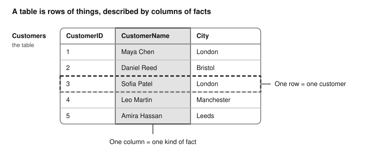

# Chapter 1 — The Database You Already Understand

By the end of this chapter, you will be able to write and run simple SQL queries, read their results, and use the same ideas to answer new questions about data.

**Why bother?** We organize information every day: contacts in a phone, products in a shop, bookings for a trip. As that information grows, finding answers by hand becomes slow and error-prone. SQL lets you ask a question about the data and leaves the searching to the database. With a well-designed database, even complex questions about large amounts of data can be answered efficiently. It is also the shared language of many database systems, so what you learn here carries over.

**What you need:** A web browser. No SQL or programming experience is required, and you can work through the chapter at your own pace.

## You already think in tables

Let's start with something familiar: a shopping list. Suppose you're planning to bake a cake and write down the ingredients you need:

- Flour
- Sugar
- Eggs
- Butter

Your list tells you what to buy, but not how much. How much flour do you need? How many eggs? To make the list more useful, you add a quantity next to each ingredient:

| Ingredient | Quantity |
| --- | --- |
| Flour | 250 g |
| Sugar | 150 g |
| Eggs | 3 |
| Butter | 100 g |

Look at what you have built. Each line describes one ingredient, and every line records the same kinds of information about it. A characteristic that we choose to record is called an **attribute**. Here the attributes are Ingredient and Quantity, and each one is a column of the table.

Database people use three words for this structure, and they are all you need for now:

- A **table** organizes information about similar items into rows and columns.
- A **row** represents a person, product, order, or another item. It contains the values recorded for that item in the table's columns.
- A **column** holds one attribute of those items, such as the quantities.

One more idea, and it matters more than it looks. Your list is not the cake, and it is not the supermarket: it records only what you need for one job. The information we choose to store determines which questions we can answer using that data. For example, if our shopping list records ingredients and quantities but not prices, we cannot calculate the total cost.

## Meet SimpleStore

Throughout this book you will query one small, fictional store called **SimpleStore**. A **database** is an organized collection of data that can be stored, retrieved and managed, and SimpleStore's database has four tables. For now we need only the first, `Customers`:

| CustomerID | CustomerName | City |
| --- | --- | --- |
| 1 | Maya Chen | London |
| 2 | Daniel Reed | Bristol |
| 3 | Sofia Patel | London |
| 4 | Leo Martin | Manchester |
| 5 | Amira Hassan | Leeds |



The highlighted column holds one attribute, the customers' names. The highlighted row holds the information recorded about one customer in this table.

Why the `CustomerID` column? Two customers could share a name, and a database must never confuse them. So we give every customer an ID number that is unique within the `Customers` table. A column, or group of columns, that uniquely identifies each row in a table is called its **primary key**, and `CustomerID` is the primary key of `Customers`. Nearly every table you meet will have one, and in Chapter 6 you will see how tables can use these IDs to refer to each other.

SimpleStore also has three other tables: `Products`, `Orders`, and `OrderItems`. We'll explore them as we learn to answer more interesting questions.

## Your first query

**Step 1. Open the lab.** In your browser, go to <https://cristianlefter.github.io/sql-made-simple/>. It needs no account and nothing to install, and SimpleStore is already loaded. For browser troubleshooting or optional local SQLite setup, see the [Quick Start](../QUICK-START.md).

**Step 2. Check that it works.** The lab opens with this query ready in the box. Press **Run** (or Ctrl+Enter) and look at the answer:

```sql
SELECT COUNT(*)
FROM Customers;
```

`COUNT` answers the question "how many?". `COUNT(*)` returns the number of rows in a table, and `Customers` has one row per customer, so the result is **5**. (Later you will also count only the rows that meet a condition, or count within groups.) If you see 5, your lab is ready. If you get a different result or an error message, consult the troubleshooting section in the [Quick Start](../QUICK-START.md) before continuing.

**Step 3. Ask a real question.** Imagine a colleague asks: *"Who are our customers, and where do they live?"* In SQL:

```sql
SELECT CustomerName, City
FROM Customers;
```

Read it as a sentence: **select the customer name and city from the customers table.**

- `SELECT` specifies which columns or expressions you want to appear in the query result.
- `FROM` specifies the source of the data, such as the `Customers` table.
- The semicolon `;` marks the end of a statement. Some tools let you leave it out for a single statement, but ending every statement with one is a good habit.

A **statement** is a complete SQL instruction sent to the database. It can retrieve information, create a table, add data, or modify existing data. `SELECT` can also show calculated values, called **expressions**: an expression is anything the database evaluates to a value, such as a price increased by 10 percent: `UnitPrice * 1.10`. You will write expressions in Chapter 2.

**Predict, then run.** How many columns and how many rows do you expect? Decide first, then run the query and compare. You should see two columns and five rows, one per customer:

| CustomerName | City |
| --- | --- |
| Maya Chen | London |
| Daniel Reed | Bristol |
| Sofia Patel | London |
| Leo Martin | Manchester |
| Amira Hassan | Leeds |

Your tool may list the rows in a different order. That is not a mistake: without `ORDER BY`, SQL does not guarantee the order of the rows. You will learn to control the order in Chapter 4.

Two things to notice.

First, notice that you told SQL what information you wanted, not how to find it. You didn't specify which row to examine first or how to search through the table. For queries like these, SQL is **declarative**: you describe the result you want, and the database engine determines how to retrieve it. That is also why the same query can run on a table with five rows or five million.

Second, the queries in this chapter only read data. A `SELECT` statement like these does not change anything in SimpleStore, so you cannot damage the data by running it. Experiment freely.

## Change the question

Reading a query is not the same as writing one. For each experiment, predict first, then run it and compare.

**Experiment 1. Only the names.** Change the previous query so that it returns only `CustomerName`. Before you run it, predict how many rows and columns you expect. Then run it and compare.

**Experiment 2. Only the cities.** Write a query that returns only the `City` column. Before you run it, predict how many rows will come back and whether any value will repeat. Then run it and compare.

**Experiment 3. Swap the order.** Write a query that selects `City` before `CustomerName`, and compare its result with your original query. What changed? Worked answers to all three experiments are in Answers at the end of the chapter.

## Choosing columns and choosing rows

So far, every query returned all five customers. What if you want only some of them? Now the colleague asks a sharper question: *"Which customers live in London?"*

Before writing any SQL, look back at the `Customers` table and answer by reading it: how many customers live in London, and who are they? Notice what your mind just did. It made **two separate decisions**:

- **Which facts do I want?** The customers' names and cities. This chooses *columns*.
- **For which customers?** Only those in London. This chooses *rows*.

`SELECT` chooses the columns. A second clause, `WHERE`, evaluates a condition for each row and keeps only the rows that satisfy it. Reading a small table by eye is easy; SQL gives you a way to answer the same question that keeps working when the table has thousands of rows:

```sql
SELECT CustomerName, City
FROM Customers
WHERE City = 'London';
```

| CustomerName | City |
| --- | --- |
| Maya Chen | London |
| Sofia Patel | London |

Here is how it works. For each row, the database compares the value in the `City` column with the text `'London'`. Rows that match appear in the result. Text values go inside **single quotes**: `City` is a column, `'London'` is a text value to look for, and the quotes tell SQL which is which. `WHERE` is covered in depth in Chapter 3; for now, just notice how it filters the customers by `City = 'London'`. Keep the habit this preview gives you. Before writing any query, ask:

1. Which table holds the information?
2. Which columns do I need?
3. Which rows do I need: all of them, or only some?

## What SQL is, and what it is not

SQL stands for **Structured Query Language**. *Structured* because it works on data organized into tables with named columns. A *query* is a request for information or a computed result. A *language* because it has rules the database can understand.

SQL is a language, not a product. Database systems such as SQLite, SQL Server, PostgreSQL and MySQL all understand it. They share a common foundation, but some SQL features, syntax, and behaviors differ between database systems. This book teaches the shared core. The lab runs on SQLite, a lightweight database system, and what you learn transfers to SQL Server, PostgreSQL and MySQL. The book points out the differences that matter.

SQL can read data, combine tables, calculate summaries, and also add, change and remove data. This book is mostly about asking questions, because asking questions is the skill underneath everything else SQL does.

## When things go wrong

Everyone's first queries fail sometimes. The skill is reading what the database tells you. Start with a real one. Run this query, read the message, and decide what is wrong. Then fix it and run it again:

```sql
SELECT CustomerName, Citty
FROM Customers;
```

Whenever a query fails, work the same way: read the error message, review your SQL, identify the mistake, fix it, and run it again. The messages below come from SQLite; other systems may report the same problems with different wording.

| You typed | You see | What happened |
| --- | --- | --- |
| `SELECT CustomerName, Citty FROM Customers;` | `no such column: Citty` | A column name is misspelled. |
| `SELECT CustomerName, City FROM Customer;` | `no such table: Customer` | The table name is wrong (it is `Customers`). |
| `SELECT CustomerName, City, FROM Customers;` | `near "FROM": syntax error` | A stray comma before `FROM`. |
| `... WHERE City = London;` | `no such column: London` | Without quotes, `London` is read as a column name. |
| `SELECT CustomerName, City Customers;` | `no such column: CustomerName` | `FROM` is missing. The message points at a different spot from your slip. |

The last row teaches something general: a message shows where the database got confused, which is not always where you made the mistake. Read the whole query, not only the position the message names.

Not every mistake produces an error message. Sometimes SQL executes your query successfully but returns a result you didn't expect. Let's look at an example. Run this query:

```sql
SELECT CustomerName, City
FROM Customers
WHERE City = 'london';
```

Before reading on, answer these: Did you get an error? How many rows came back? Why do you think nothing matched? Change the query so that it returns Maya and Sofia.

The query runs without any error and returns **no rows**. By default, SQLite compares text exactly when you use `=`, including capital letters, and the stored value is `London`, not `london`. We will see later that we can change this behavior using collations (different comparison rules). A successful query can legitimately return zero rows, but an unexpected empty result usually means the condition is not what you meant, so check the spelling and capitalization of your text values first. (Other databases may treat capitals differently, one of the differences this book will point out.)

One more habit worth building now: SQL keywords like `SELECT` are not case-sensitive, so `select` works too. Pick a consistent style and keep to it. This book writes keywords in capitals so they stand out from table and column names.

## Pocket reference

| You want to... | Pattern |
| --- | --- |
| Read one column | `SELECT ColumnName FROM TableName;` |
| Read several columns | `SELECT ColumnA, ColumnB FROM TableName;` |
| Keep only matching rows | `SELECT ColumnName FROM TableName WHERE ColumnName = 'Value';` |
| Count the rows in a table | `SELECT COUNT(*) FROM TableName;` |

**Remember**

- `SELECT` chooses columns. `FROM` names the table. `WHERE` chooses rows.
- Columns come back in the order you list them.
- Text values go in single quotes. Column names are normally written without quotes; some names require special quoting.
- Without `ORDER BY`, row order is not guaranteed.
- The `SELECT` queries in this chapter only read data.
- An error message helps identify what went wrong. An empty result with no error means the query ran but asked something other than what you meant.

**Words you now know**

| Word | Meaning |
| --- | --- |
| Table | Organizes information about similar items into rows and columns |
| Row | One item in a table, such as one customer, with the values recorded for it |
| Column | An attribute of the items represented in a table, such as `City` for customers |
| Query | A request for information or a computed result |
| Statement | A complete SQL instruction sent to the database. It can retrieve information, create a table, add data, or modify existing data. |
| Declarative | Describing the result you want and leaving the database engine to determine how to produce it |

## Prove you can do it

A new colleague asks: *"Which products do we sell, and what does each one cost?"*

The answer lives in a table you have not queried yet. It is called `Products`, and its columns are `ProductID`, `ProductName`, `Category` and `UnitPrice`. Write the query yourself, without looking back at the examples. Click **Run** to see your result. Then, under **Check my answer**, select *Chapter 1, Prove you can do it: products and prices* and click **Check my answer** to verify it. The check ignores row order, because SQL does not promise one.

**Success check.** Your result must have:

- exactly **two columns**, `ProductName` and `UnitPrice`, in that order
- exactly **six rows**
- `Notebook` appearing as a row priced 4.5, in any position (some tools show 4.50; the value is the same)

If your result does not match:

- **An error message:** compare it with the errors table above.
- **The wrong number of columns:** check the list between `SELECT` and `FROM`.
- **The right shape but strange values:** check that you named `Products`, not `Customers`.

**Second check: predict without running.** What will `SELECT Category FROM Products;` return? How many rows, and which values repeat? Write down your answer, then run the query to test it.

**Optional stretch: think it through.** A library owns two physical copies of the same book. If you were designing a table for the library's books, what would one row represent? Could the same table describe both the title and each individual copy without causing confusion?

Try each task yourself first. Worked answers are in [Answers](#answers) at the end of the chapter.

## Before you move on

Tick each statement only if you could demonstrate it now, not just recognize it when you read an explanation.

- [ ] I can explain what a table, a row and a column are, using an example of my own.
- [ ] I ran `SELECT COUNT(*) FROM Customers;` and saw 5.
- [ ] I can read a `SELECT ... FROM ...;` query aloud as a sentence, identify which columns it returns, and predict how many rows it returns when I know the contents of the source table.
- [ ] I can choose which columns a result shows, and in which order.
- [ ] I know that a result has no guaranteed row order without `ORDER BY`.
- [ ] I can tell "no such column" from "no such table", and I know what an empty result with no error might mean.

You can now write simple SQL queries to retrieve information from a table. In Chapter 2, you'll build on that skill by giving result columns meaningful names, performing calculations, and creating more useful query results.

## Answers

Look here only after you have tried the tasks yourself.

**Experiment 1. Only the names**

```sql
SELECT CustomerName
FROM Customers;
```

One column and five rows: the same five customers, without the `City` column.

**Experiment 2. Only the cities**

```sql
SELECT City
FROM Customers;
```

Five rows, one per customer. London appears twice because two customers live there, and a query returns one row for each row it reads. `DISTINCT`, which you will meet in Chapter 4, removes duplicate rows from a result: `SELECT DISTINCT City FROM Customers;` lists each city once.

**Experiment 3. Swap the order**

```sql
SELECT City, CustomerName
FROM Customers;
```

The same five rows, with the columns in the order you listed them, not the order they have in the table. You decide the shape of the answer.

**When things go wrong: the two practice queries**

The first query misspells `City` as `Citty`. The corrected query is `SELECT CustomerName, City FROM Customers;`. The second query returns no rows because `'london'` does not match the stored value `London`. Writing `'London'` returns Maya and Sofia.

**Prove you can do it: products and prices**

```sql
SELECT ProductName, UnitPrice
FROM Products;
```

It has the same shape as your first query, with a different table and different columns. That is the skill: not remembering one query, but reading a question, naming the table, naming the columns, and writing the sentence.

**Second check: predict without running**

Six rows, one per product. `Stationery` and `Accessories` each appear twice, for the same reason London appeared twice earlier: each row is one product, and two products can share a category. If you predicted that, you are reading queries, not just typing them.

**Optional stretch: think it through**

A title and a copy are different things. One copy can be borrowed while the other is on the shelf, yet both share one title and author. A single table makes you either repeat the title details for every copy or lose track of which copy is which, so designers use two tables, one for titles and one for copies, linked by an ID. You will build exactly that kind of link in Chapter 6.